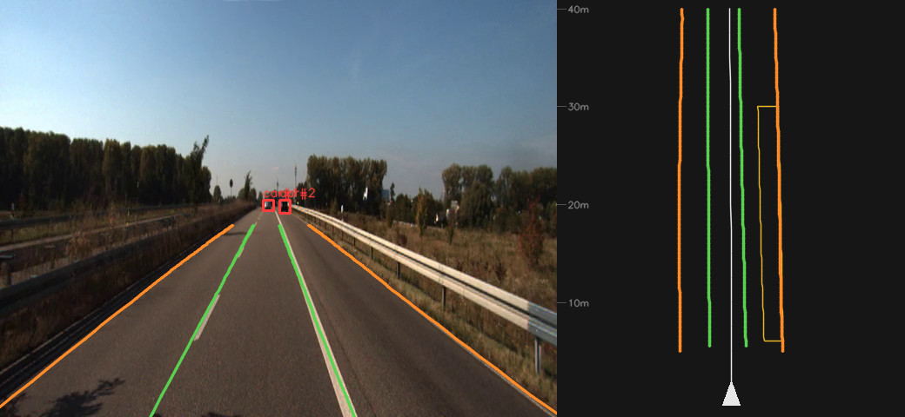
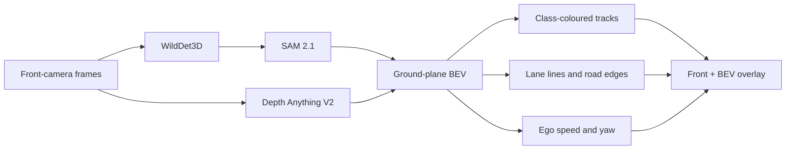

# Front BEV Tracks

Front-camera driving video in; a side-by-side front and bird's-eye overlay out, with class-coloured tracks, lane lines, road edges, and the ego path.



The still is from the public KITTI clip `kitti_highway_exit_approach`, rendered by the foundation pipeline (iter15). Videos themselves are not stored in this repository.

## What this project does

Given a front-camera clip, camera intrinsics, and (for the overlay path) a motion file, the tools in this repo lift detections onto the ground plane and draw:

- **Tracks** for cars, people, and bicycles, in the front view and in a bird's-eye panel
- **Lane-line** and **road-edge** curves, kept as separate classes
- The **ego path**

There are two lines of work. `main` is a YOLOPv2 overlay pipeline that runs on CPU once you have weights, a video (or frames), a motion file, and a camera file. `foundation-bev` is a later foundation-model pipeline that does not use YOLO or TwinLiteNet inside the run; YOLOPv2 is kept only as a measurement baseline.

## Branches

| Branch | Role |
|---|---|
| [`main`](https://github.com/sudeshgm/front-bev-tracks/tree/main) | YOLOPv2 overlay pipeline: front-camera video in, front + bird's-eye video out. Default branch. |
| [`lane-solver-fast`](https://github.com/sudeshgm/front-bev-tracks/tree/lane-solver-fast) | Same overlay line, plus SAM + Depth Anything and other model-compare BEV overlay scripts. |
| [`foundation-bev`](https://github.com/sudeshgm/front-bev-tracks/tree/foundation-bev) | Foundation-model BEV pipeline (WildDet3D + SAM 2.1 + Depth Anything V2). Current validated release is **iter15**. |

## Foundation pipeline

On `foundation-bev` the run is two model stages, then tracking, line fitting, ego-motion estimation, and a BEV render. TwinLiteNet and YOLO are never used inside this pipeline.



1. **WildDet3D** — open-vocabulary 3D boxes for `car`, `person`, and `bicycle`, plus prompt boxes for lane lines and road edges.
2. **SAM 2.1** — box-prompted masks.
3. **Depth Anything V2** — per-pixel depth, lifted onto a ground-plane bird's-eye view.
4. **Tracks and lines** — ByteTrack-style association with a Kalman filter; lane lines and road edges are tracked separately.
5. **Ego speed and yaw** — on the six KITTI clips, yaw and speed are scored against KITTI OXTS (GPS/IMU) ground truth.

Details, environment variables, and earlier iteration history live in [`foundation_bev/README.md`](https://github.com/sudeshgm/front-bev-tracks/blob/foundation-bev/foundation_bev/README.md) on the `foundation-bev` branch.

## Output legend

| Element | Colour |
|---|---|
| Car tracks | Red |
| Person tracks | Magenta |
| Bicycle tracks | Cyan |
| Lane lines | Green |
| Road edges | Orange, kept separate from lanes |
| Ego path | White |
| Gore / split outline | Lighter orange |

The bird's-eye panel shows only those elements. It does not draw depth maps, edge maps, or masks.

## Key results (iter15)

Validated on a T4 GPU over nine public clips (six KITTI, one Munich dashcam, two A2D2). Yaw and speed figures are from [`ego_eval_oxts.txt`](https://github.com/sudeshgm/front-bev-tracks/blob/foundation-bev/foundation_bev/results/iter15/ego_eval_oxts.txt) and iter15 [`metrics.md`](https://github.com/sudeshgm/front-bev-tracks/blob/foundation-bev/foundation_bev/results/iter15/metrics.md). The YOLOPv2 smoothness column is the committed measurement-only baseline in [`results/iter13/metrics_yolo_vs_run.md`](https://github.com/sudeshgm/front-bev-tracks/blob/foundation-bev/foundation_bev/results/iter13/metrics_yolo_vs_run.md); iter15 did not re-publish that file. Iter15 lane-width jitter on these KITTI clips matches the iter13 working run, except `kitti_highway_final` (0.006 → 0.008), which is now equal to the baseline.

**Ego yaw versus KITTI OXTS** (mean absolute error, deg/s). Iter15 fixes a sign error that had mirrored drawn turns since iter3, and estimates yaw from ECC alignment of consecutive road-masked BEV frames:

| Clip | Before | Iter15 |
|---|---:|---:|
| `kitti_highway_sample` | 0.51 | 0.11 |
| `kitti_highway_exit_approach` | 1.40 | 0.13 |
| `kitti_highway_late` | 3.48 | 0.86 |
| `kitti_highway_final` | 0.59 | 0.21 |
| `kitti_city_cyclist_candidate` | 0.88 | 0.41 |
| `kitti_lane_split_candidate` | 24.42 | 1.13 |

Yaw MAE is lower on all six KITTI clips.

**Ego speed versus KITTI OXTS.** Mean absolute speed error on the six KITTI clips fell from 7.7% to 5.6%. `kitti_highway_late` went from −9.2% to +0.4% and `kitti_highway_exit_approach` from −4.0% to +2.6%. `kitti_highway_final` is the clip that got worse (−1.5% to +4.0%). `kitti_lane_split_candidate` stays at −18% (the pitch correction does not run when there are fewer than five lane pairs).

**Lane smoothness versus the YOLOPv2 baseline.** Median lane-width jitter at 10 m ahead (metres; lower is smoother). On the straight KITTI highway and city clips, iter15 is at or below the baseline; on `kitti_lane_split_candidate` width jitter remains higher (0.131 vs 0.092), which the iter notes treat as structural.

| Clip | Iter15 | YOLOPv2 baseline |
|---|---:|---:|
| `kitti_highway_sample` | 0.001 | 0.006 |
| `kitti_highway_exit_approach` | 0.007 | 0.007 |
| `kitti_highway_late` | 0.006 | 0.009 |
| `kitti_highway_final` | 0.008 | 0.008 |
| `kitti_city_cyclist_candidate` | 0.001 | 0.005 |
| `kitti_lane_split_candidate` | 0.131 | 0.092 |

The ID-switch proxy is 0 on all nine public clips. Gores appear only at the real exit on `kitti_highway_exit_approach` (frames 21–26) and on `munich` (frames 760–765).

## Quick start

### Overlay pipeline (`main`)

Each run needs a video (or a folder of frames), a motion file, and a camera file. CPU is enough. The clip itself is not in the repo.

```bash
git clone https://github.com/sudeshgm/front-bev-tracks
cd front-bev-tracks
python scripts/overlay.py \
    --video clip.mp4 \
    --motion clip_motion.csv \
    --camera clip_camera.json \
    --weights yolopv2.pt \
    --output overlay.mp4
```

Needs PyTorch, OpenCV, and ffmpeg. One output frame is written per motion row.

`--weights` is a TorchScript YOLOPv2 model. Input is `1x3x640x640` RGB in 0–1. It must return `(detections, drive, lanes)`: three detection scales with 85 channels, and a lane mask on that same 640 canvas. The image is letterboxed into rows 140:500. Pass `--cache` to reuse detections, and `--recompute` to ignore a cache.

Useful flags:

- `--repeat 2` when the file stores each camera frame twice. The motion file still has one row per camera frame.
- `--frames DIR` instead of `--video` when you already have one colour image per motion row (PNG or JPEG, sorted by filename). OpenCV reads them as BGR. The output video is tagged BT.709, limited range. Do not boost saturation before detection.
- `--lane-backend twinlite` runs [TwinLiteNet+](https://github.com/chequanghuy/TwinLiteNetPlus) (MIT) for lane lines and takes road edges from the sides of its drivable-area mask. Vehicle boxes stay with YOLOPv2. `--lane-code` is a checkout of that repo and `--lane-weights` is its `large.pth`. `--reuse-boxes cache.npz` keeps an existing box cache.
- `--wilddet results/wilddet.json` draws a second set of boxes from WildDet3D on top of the tracks. The JSON comes from `scripts/wilddet_clip.py` on a GPU.

A self-check, with no GPU:

```bash
python scripts/test_tracks.py
```

#### Motion file

CSV with header `t_s,speed_mps,yaw_rate_rps`. One row per camera frame. `t_s` is seconds and must increase. `speed_mps` is the ego speed. `yaw_rate_rps` is radians per second, **positive to the left**. Axes are ISO 8855: x forward, y left, z up.

#### Camera file

JSON. Intrinsics match the video's image size. `position_m` is the camera in the vehicle frame, in metres. The image is a CylinderV01 virtual view, already unrotated, so the view rotation is identity and there is no extra lens term.

```json
{
  "fx": 0.0,
  "fy": 0.0,
  "cx": 0.0,
  "cy": 0.0,
  "position_m": [0.0, 0.0, 0.0],
  "width": 1280,
  "height": 720
}
```

A ground point in the camera frame projects as `u = cx - fx·atan2(y, x)` and `v = cy - fy·z / hypot(x, y)`. There is no pixel when `x <= 0`. The lift is the inverse of that onto the ground plane `z = 0`.

Vehicles are tracked with a constant-velocity Kalman filter, forward and back. Association allows a large error along the road and a small error sideways. After the last detection, a moving track is continued for up to two seconds and those points are marked predicted. Cyclists and pedestrians are not in the YOLOPv2 boxes; they come from `--wilddet`.

Each lane marking is one curve on the ground. The front view and the bird's-eye view both draw the part of that curve the camera can see. With `--lane-backend twinlite`, road edges are drawn in orange and lane lines in green.

### Foundation pipeline (`foundation-bev`)

```bash
git clone https://github.com/sudeshgm/front-bev-tracks
cd front-bev-tracks
git checkout foundation-bev
cd foundation_bev
export FBEV_DS=/path/to/dataset
export FBEV_OUT=/path/to/output
export FBEV_TMP=/path/to/scratch
python src/run_iter15.py
```

`FBEV_DS` must contain the clip videos, `cams.json`, `motion_assumptions.json`, and this package (`src/`, `cams_iter13.json`). A typical GPU run on one T4 takes about 75 minutes for stage 1, stage 2, and the optional YOLOPv2 baseline. See [`foundation_bev/README.md`](https://github.com/sudeshgm/front-bev-tracks/blob/foundation-bev/foundation_bev/README.md) for environment variables, tests, and the full clip list.

## Repository layout (`main`)

```
compat/                 # lightweight mmcv shims for the overlay path
data/                   # clip manifest only; videos are not stored here
ops/                    # CPU and GPU run notes
qdtrack/                # tracker, geometry, and lane tests
scripts/overlay.py      # front + bird's-eye overlay entry point
scripts/test_tracks.py  # CPU self-check
scripts/                # lift, fusion, WildDet helpers, and GPU job scripts
docs/                   # README stills
requirements-gpu.txt
requirements-lift.txt
```

On `foundation-bev`, the package lives under `foundation_bev/` (`src/run_iter15.py`, `SPEC.md`, tests, and `results/iterN/`).

## Licence

This repository does not currently include a licence file. Upstream models used by the pipelines (including YOLOPv2, TwinLiteNet+, WildDet3D, SAM 2.1, and Depth Anything V2) remain under their own licences.
